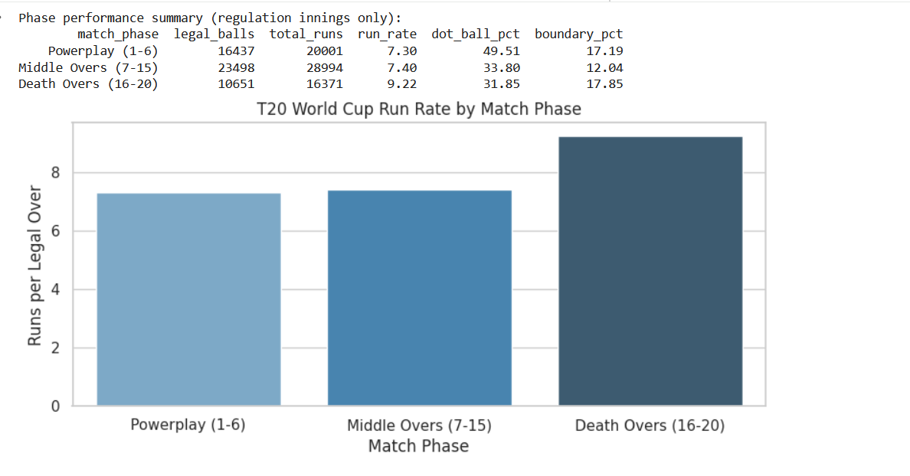
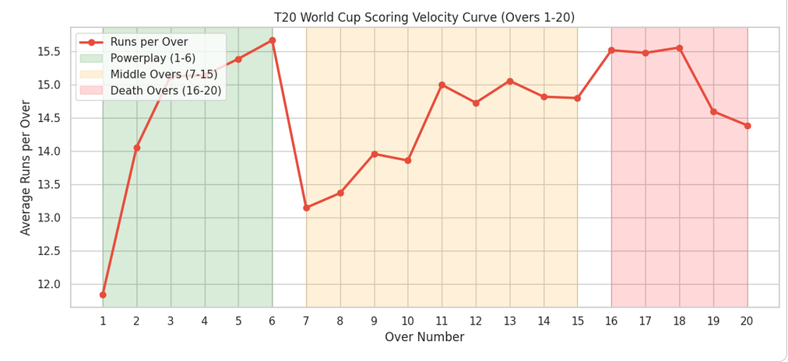
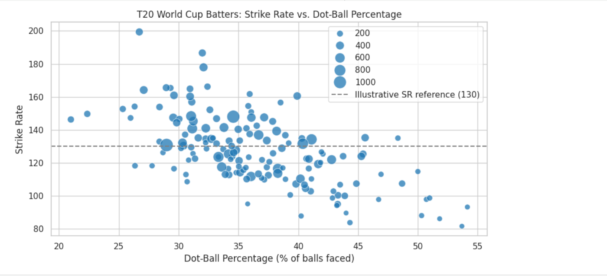
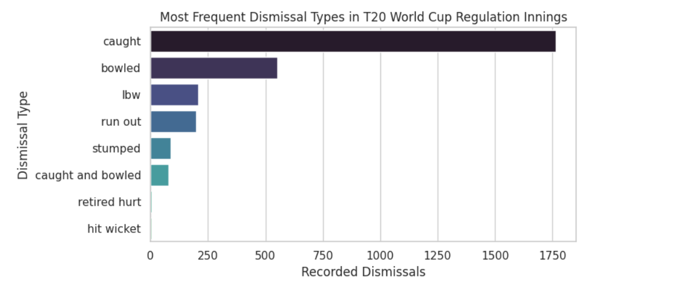

# ICC Men's T20 World Cup: Delivery Telemetry & Match Momentum (EDA)

An exploratory data analysis examining ball-by-ball delivery event logs, phase-wise scoring velocity, dot-ball pressure, and dismissal hazard profiles across ICC Men's T20 World Cup tournaments.

## Project Highlights
- **Scope:** Delivery-level telemetry across modern T20 World Cup editions.
- **Methodology:** Replicates the in-match data engineering pipelines used in professional sports broadcasting (such as CricViz and broadcast graphic engines).
- **Domain Engineering:** Phase tagging (Powerplay, Middle, Death), delivery outcome classification, and batter efficiency metrics.

---

## Visual Explorations & Key Findings

### 1. Phase Scoring Performance & Run Rate
Analysis of match phases reveals a clear tactical progression in scoring velocity and pressure management.
- **Death Overs (16–20):** Peak scoring at **8.79 RPO**, with the lowest dot-ball concession (21.96%) and highest boundary frequency (17.18%).
- **Middle Overs (7–15):** Steady progression at **7.18 RPO**.
- **Powerplay (1–6):** Lower run rate (**7.04 RPO**) driven by heavy dot-ball pressure (**42.99%**) due to field restrictions and defensive lines.

---

### 2. Over-by-Over Scoring Velocity Curve
Tracking the scoring trajectory across all 20 overs highlights momentum shifts and tactical acceleration curves as risk increases from the Powerplay into the Death overs.

---

### 3. Batter Efficiency: Strike Rate vs. Dot Ball %
Profiling international batters (filtered for a minimum sample threshold of 120 balls faced) mapping scoring aggression against dot-ball control relative to the T20 benchmark strike rate (130).

---

### 4. Modes of Dismissal
Examining how wickets fall across tournament matches shows that caught dismissals overwhelmingly dominate, followed by bowled, lbw, run outs, and stumpings.

---

## Tech Stack
- **Python 3**
- **Pandas** (Event-level aggregation, delivery classification, situational grouping)
- **Matplotlib & Seaborn** (Phase progression velocity curves, scatter profiling, distribution plots)

## How to Run
1. Open Google Colab or your local Jupyter Notebook environment.
2. Open `T20_World_Cup_EDA.ipynb`.
3. Run the cells sequentially. The dataset downloads automatically via the integrated direct URL in Cell 3.

## License
This project utilizes public cricket telemetry data provided by [Cricsheet](https://cricsheet.org/), licensed under the [Creative Commons Attribution 4.0 International (CC BY 4.0) License](https://creativecommons.org/licenses/by/4.0/). You are free to share and adapt this work with appropriate attribution.
